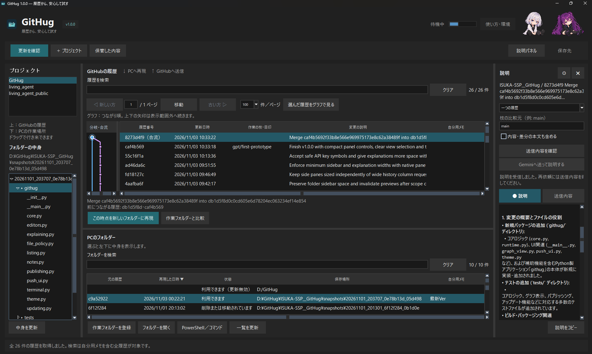

# GitTotte

旧名：GitHug。Gitに「取っ手」を付ける、Windows用の操作アプリです。

## 開発中のPython版

このブランチは1.1.0a14です。今回はEXEを作成せず、Python版で確認します。

```powershell
python -m pip install -r requirements.txt
python -m gittotte
```

履歴の下の「比べる・取り込む → 別の作業ルートと比較・取り込み提案」から、取り込み元 → 取り込み先を選んで比較できます。提案の作成・合流の確定はGitHub側で行います。

PCのフォルダーを右クリックして「PCに記録だけ残す」を選ぶと、GitHubへ送信せず記録できます。「保管した内容 → PCの記録」から変更を確認し、後から保存済みの記録を送信できます。

「保管した内容 → PCの記録／更新前バックアップ」で項目を選び、「新しいフォルダーへ復元」から取り出せます。毎回別のフォルダーを作り、元のデータは変更しません。復元したフォルダーはPCの一覧に追加され、元のフォルダーの自分用メモも引き継ぎます。上書き更新は最初はOFFです。

PCのフォルダーはCtrl・Shiftで複数選択できます。右クリックからまとめてごみ箱へ移動したり、見つからない項目だけ一覧から取り除けます。複数選択中は送信しません。

画面上の「表示用語：操作名／Git用語」はその場で切り替わり、次回にも引き継ぎます。既存の設定・登録フォルダー・自分用メモ・保存済みAPIキーは引き続き利用できます。設定は互換性のため `%APPDATA%\GitHug` を使用します。

以下のv1.0.0配布物・画像は旧名GitHugのものです。

**履歴から、安心して試す。**

GitHubのファイルを、Windowsのフォルダー操作に近い感覚で扱う無料のデスクトップアプリです。
履歴を選んでPCへドラッグすると、その時点のファイルを別フォルダーに再現。
PCのフォルダーからGitHubへドラッグすると、変更を確認して送る画面を開きます。



GitHubの履歴とPCのフォルダーを、ドラッグでつなぐ。説明パネルは必要なときだけ開けます。

右上の二人は、デスクトップマスコット **LivingAgent** のキャラクターです。

[LivingAgentの紹介・配布ページ](https://github.com/ISUKA-SSP/living_agent_public/) ／ [LivingAgentのダウンロード](https://github.com/ISUKA-SSP/living_agent_public/releases)

## ダウンロード

**[Windows版 v1.0.0 をダウンロード](https://github.com/ISUKA-SSP/GitTotte/releases/download/v1.0.0/GitHug-1.0.0-Windows-x64.zip)**

[配布ページ・更新内容](https://github.com/ISUKA-SSP/GitTotte/releases/latest)

Windows 11・64bit向け。Pythonのインストールは不要です。公開プロジェクトの取得に使うGitも同梱しています。

1. ZIPを**すべて展開**します。
2. 展開した `GitHug` フォルダー内の **GitHug.exe** を開きます。
3. 「保存先」で、再現フォルダーを保管する場所を選びます。
4. 「＋ プロジェクト」でGitHubのURLを追加します。

`GitHug.exe` だけを取り出さず、`_internal`・`tools` などを含めて使ってください。
インストーラーはありません。アプリを終了すれば、展開したアプリのフォルダーは移動できます。

## できること

| やりたいこと | 操作 |
|---|---|
| 過去や最新の版を試す | 上の履歴を下の空白へドラッグして、新しいフォルダーに再現 |
| 同じフォルダーを別の版に更新する | 履歴を対象フォルダーの行へドラッグし、差分と保管方法を確認 |
| PCで編集した変更をGitHubへ送る | 下のフォルダーを上へドラッグし、送るファイル・送信先・変更の説明を確認 |
| 枝分かれや合流を追う | 履歴のグラフを確認。境目をドラッグして幅を調整 |
| ファイルを探して開く | PCのフォルダーを選び、左下のツリーを開く。ファイルはダブルクリック |
| よく使う版を覚えておく | 行を右クリックして自分用メモを付ける。メモも検索対象 |
| エディタやコマンドを使う | 右クリックからVS CodeやPowerShellで開く |
| 変更の説明を読む | 任意の「説明パネル」を開き、内容を確認してGeminiへ依頼 |

履歴は全件取得し、検索・並べ替え・ページ切り替えに対応します。
ダークテーマで、上下の一覧や左右のパネルの幅を調整できます。

## 手元のファイルの扱い

- 履歴の取得だけでは、作業フォルダーを更新しません。
- 別フォルダーへの再現は、毎回新しい場所に作成します。
- 同じ場所への更新は、確認後にだけ実行します。今の内容をZIPで保管する選択肢があります。
- 「手元だけのファイルを残す」は初期状態でONです。追跡済みファイルの編集は、選んだ版に置き換わります。
- 作成元が不明なフォルダーは、そのまま上書き更新できません。
- GitHubへの送信は一時コピーから行い、送信元のフォルダーやそのGit管理情報を直接変更しません。

大切なデータには別のバックアップも用意してください。
[更新・送信時の詳しい動作と制限](docs/操作ガイド.md)を確認できます。

## GitHubへの送信・非公開プロジェクト

PC側でGitHubへの認証と、対象プロジェクトへの権限が必要です。
Git for Windowsがインストールされている場合はそちらを優先し、普段の認証設定を使います。
同梱Gitだけでは認証の準備が済んでいるとは限りません。
ChatGPTのGitHub接続は、GitTotteには引き継がれません。

既存の枝と変更が食い違う場合は、新しい枝へ送る形を案内します。
変更の自動統合や、競合した箇所を編集する機能はありません。

## AIによる説明（任意）

Geminiを使わなくても、GitTotteの基本機能は利用できます。

1. 「説明パネル」を開き、⚙から利用するモデル名とAPIキーを設定します。
2. 履歴・ファイルを選び、「送信内容を確認」で対象を確認します。
3. 「Geminiへ送って説明する」を押します。

選択しただけでは送信しません。本文・差分を含めるかも選べます。
APIキーは初期状態では保存しません。接続設定から希望した場合だけWindowsの資格情報マネージャーへ保存できます。設定ファイルにキーを書きません。モデル名は保存します。
Google側の利用条件・料金・上限が適用されます。AIの説明には推測や誤りが含まれる場合があります。
設定・DB・鍵などはファイル名で除外しますが、コード中の秘密情報を完全に検出する機能ではありません。送信前の表示を確認してください。

## 設定・保管先

設定は `%APPDATA%\GitHug\settings.json` に保存します。
再現フォルダー・履歴・更新前の保管ZIPなどは、アプリで指定した保存先にあります。
アプリ本体を削除しても、それらのデータや設定は自動削除しません。

## 制限・動作確認

- submoduleやGit LFSの実体取得、Pythonなどの実行環境の自動準備には対応していません。
- Windows版はコード署名を付けていません。環境によって警告が出る可能性があります。
- v1.0.0は84件のテスト、Windows上でのEXE起動・主要画面・同梱Gitの確認、Defenderによる配布フォルダーとZIPの検査を実施しています。検査の通過は、すべての環境での動作や安全性を保証するものではありません。

不具合や要望は[Issues](https://github.com/ISUKA-SSP/GitTotte/issues)へ。再現手順・バージョン・エラー文を添えてください。APIキーや個人情報は載せないでください。

## 埋め込みPowerShell（1.1.0試用版）

PCのフォルダーを選んで「PowerShell／コマンド」を押すと、下側のパネルで操作できます。
右に複数行のコマンド、下の「途中の入力」に質問への回答を入力します。
✖はパネルを隠すだけで、処理は続きます。「処理を中断」はCtrl+C、「終了」はPowerShellとその処理を終了します。
[詳しい操作と試用版の制限](docs/changes/stage-3.md)

## ソースから起動・開発

Python 3.11以降（tkinterを含む）とGitが必要です。

```powershell
python -m pip install -r requirements.txt
python -m githug
python -m unittest discover -s tests -v
```

[詳しい操作・ビルド手順](docs/操作ガイド.md) ／ [同梱ソフトウェアについて](packaging/THIRD_PARTY_NOTICES.md)
